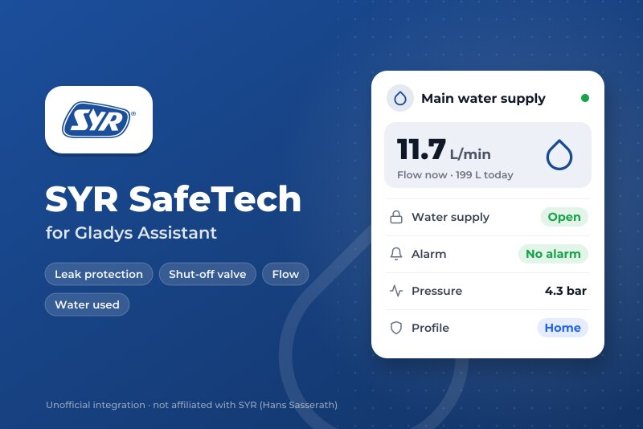
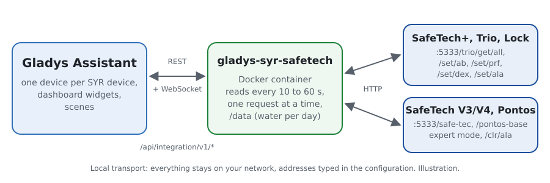
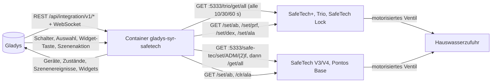
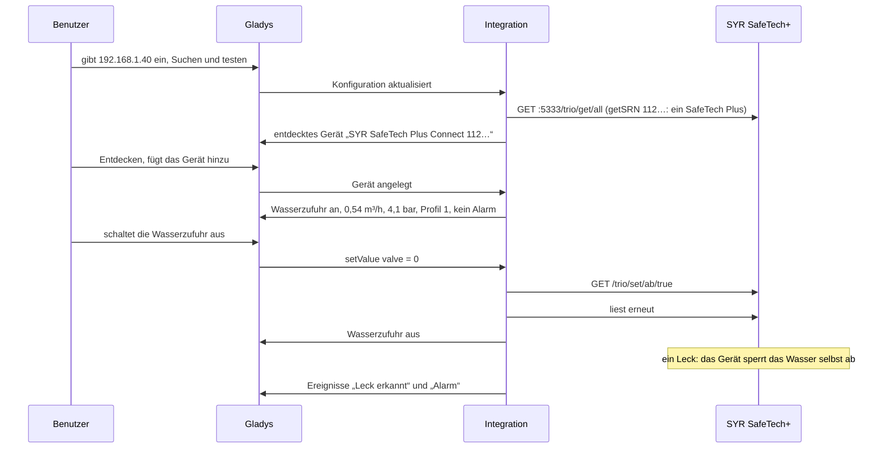

# Gladys SYR SafeTech

[English](README.md) · [Français](README.fr.md) · **Deutsch** · [Español](README.es.md)

[](LICENSE)
[](https://github.com/William-De71/gladys-syr-safetech/releases)
[](https://github.com/William-De71/gladys-syr-safetech/actions/workflows/release.yml)
[](https://gladysassistant.com)



Externe Integration für [Gladys Assistant](https://gladysassistant.com) für die **SYR-Leckageschutzgeräte**, die motorisierten Ventile an der Hauswasserzufuhr, die das Wasser absperren, wenn es zu lange oder zu stark fließt. Sie zeigt in Gladys das Ventil, die Leckalarme, Durchfluss, Druck, Temperatur und den täglichen Wasserverbrauch, lässt dich das Wasser per Schalter, Widget oder Szene absperren oder wieder öffnen und löst Szenen aus, wenn ein Leck erkannt wird — nur in deinem lokalen Netzwerk.

Benutzerdokumentation: [English](docs/en.md) · [Français](docs/fr.md) · [Deutsch](docs/de.md) · [Español](docs/es.md).

Nicht mit SYR (Hans Sasserath) verbunden. **Noch nicht mit einem echten Gerät getestet**: Anfragen und Antworten folgen der Community-Dokumentation der lokalen API (alexhass/syr_connect, Apache-2.0, und ahornung/syr-safetech-connect-api, MIT; kein Code übernommen).

## Funktionen

- **SafeTech Connect** (V3, V4, aktuell), **SafeTech+**, **Trio DFR/LS**, **Trio LS**, **SafeTech Lock**, **TRIO Lock**, **Hansgrohe Pontos Base**, **RWC MultiSafe** und ihre Zwillinge anderer Marken: Adressen in der Konfiguration eingegeben, den API-Pfad (`/trio`, `/safe-tec`, `/pontos-base`) und den Expertenmodus älterer Firmwares findet die Integration selbst; ein Gerät wird an seiner Seriennummer erkannt, eine neue IP-Adresse behält es.
- **Ein Gerät pro SYR-Gerät**: die Wasserzufuhr als Schalter, Leckmelder, Alarm im Klartext, Schutzprofil als Auswahl, Durchfluss, Druck, Wassertemperatur, Zähler, Wasserverbrauch heute, letzte und laufende Entnahme, Batterie.
- **6 Szenenauslöser** (Leck erkannt, Alarm, Alarm vorbei, Warnung, antwortet nicht, antwortet wieder), **4 Szenenaktionen** (Profil wählen, Mikroleckagetest, Alarm quittieren, Wasserverbrauch) und **2 Dashboard-Widgets** (Übersicht mit Tasten, Wasser pro Tag).
- Geräte alle 10, 30 oder 60 Sekunden abgefragt, eine Anfrage nach der anderen.
- Nur lokal, ohne Konto, ohne Cloud. Überall vier Sprachen: Englisch, Französisch, Deutsch, Spanisch.

## Funktionsweise





Von der Adresse zum Befehl:



### Transport

`transports: ["local"]`: Die Integration spricht per HTTP auf Port 5333 deines Netzwerks mit den Geräten; **keine Daten verlassen dein Zuhause**. Mit einem einzigen Kanal gibt es weder die Taste „lokale Verbindung bevorzugen“ noch ein Transport-Abzeichen pro Gerät. Die Geräte melden sich nicht im Netzwerk an: Die Adressen werden eingegeben. `/data/syr.json` (Modus 0600) speichert pro Gerät seine letzte Adresse und seinen API-Pfad, seine Werte, die gesehenen Funktionen, den ersten Zählerstand jedes der letzten 35 Tage und was die Auslöser wissen.

## Geräte und Funktionen

| Gerät     | Funktionen (Kategorie / Typ)                                                                                                                                                                                                                                                                                                                                                                                                                                                                                                                                                     |
| --------- | -------------------------------------------------------------------------------------------------------------------------------------------------------------------------------------------------------------------------------------------------------------------------------------------------------------------------------------------------------------------------------------------------------------------------------------------------------------------------------------------------------------------------------------------------------------------------------- |
| SYR-Gerät | Wasserzufuhr (`switch` / `binary`, 1 = Wasser fließt, schreibbar), Leck (`leak-sensor` / `binary`), Alarm (`text` / `text`), Schutzprofil (`text` / `select`, schreibbar, die Profile des Geräts als Optionen), Durchfluss (`water-valve` / `flow`, m³/h), Druck (`pressure-sensor` / `decimal`, bar), Wassertemperatur (`temperature-sensor` / `decimal`, °C), Zähler (`volume-sensor` / `decimal`, m³), Wasserverbrauch heute, letzte und laufende Entnahme (`volume-sensor` / `decimal`, L), Batterie (`battery` / `integer`, %), Batterie schwach (`battery-low` / `binary`) |

- Die externen IDs beruhen auf der Seriennummer: `ext:…:syr:<Seriennummer in Kleinbuchstaben>`, Funktionen `…:<Schlüssel>`.
- Das Ventil wird am Motorzustand gelesen (`getVLV`: 10 geschlossen, 11 schließt, 20 offen, 21 öffnet) und im Format gesteuert, das das Gerät meldet (`true`/`false` bei neueren, `2`/`1` bei älteren).
- Der Wasserverbrauch heute wird von der Integration berechnet: der Zählerstand bei der ersten Abfrage nach Mitternacht (Zeitzone von Gladys) und jetzt.
- Eine Funktion erscheint, sobald ihr Wert gesehen wurde (kein Drucksensor beim Trio DFR/LS, kein Batteriestand beim SafeTech, keine Ventilsteuerung beim Pontos Base): Drücke **Aktualisieren** im Bildschirm Entdecken, wenn eine später erscheint.
- Die Zustände werden bei Änderung gesendet, sonst alle 30 Minuten; ein nicht erreichbares Gerät sendet nichts (Gladys zeigt seine Werte als veraltet).

## Szenenauslöser, -aktionen und Widgets


**Widgets**: Leckageschutz (ein Gerät, standardmäßig das erste: aktueller Durchfluss, Wasserverbrauch heute, Druck, das Ventil, der Alarm, eine Warnung, die Wassertemperatur, das Profil, die Batterie, die letzte Abfrage und die Tasten „Wasser absperren“ / „Wasser öffnen“, „Alarm quittieren“ und „Mikroleckagetest“, die Gladys bestätigen lässt, bevor sich das Ventil bewegt) und Wasser pro Tag (heute, der Durchschnitt pro Tag, der Zähler und ein Balkendiagramm der letzten 14 Tage).

**Auslöser** (ein Ereignis pro Übergang, nie bei der ersten Abfrage, nie als Folge einer Aktion; Filter: das Gerät):

- **Leck erkannt**: ein Leckalarm ist aufgetreten (Mengen-, Zeit- oder Durchflussgrenze, Mikroleckage, Bodensensor); Variablen: Gerät, Name, Code, Alarm, Leck, Wasser abgesperrt, Nachricht;
- **Alarm**: jeder Alarm, Fehler inbegriffen; gleiche Variablen;
- **Alarm vorbei**: der Alarm ist am Gerät oder in seiner App verschwunden (nicht, wenn Gladys ihn quittiert);
- **Warnung** (neuere Geräte): Stromausfall, Batterie, Leckwarnung…; Variablen: Code, Warnung, Nachricht;
- **antwortet nicht**: keine Antwort auf 3 Abfragen in Folge und mindestens eine Minute lang; Variablen: Adresse, verpasste Abfragen;
- **antwortet wieder**: Variable: Minuten ohne Antwort.

**Aktionen**:

- **Profil wählen**: nach seiner Nummer in der SYR-App (1 bis 8); Ausgaben: Name, Nummer und Name des Profils, `summary`;
- **Mikroleckagetest**: das Ventil schließt etwa 4 Minuten, ein gefundenes Leck löst einen Alarm aus; Ausgabe: `summary`;
- **Alarm quittieren**: das Ventil bleibt, wie es ist; Ausgaben: der quittierte Alarm, `summary`;
- **Wasserverbrauch**: heute, gestern, Zähler, aktueller Durchfluss (L/min), Ventil offen, `summary`.

Wasser absperren oder öffnen ist die Funktion **Wasserzufuhr**: ein „Gerät steuern“ in einer Szene, wie jeder Schalter. Druck- oder Durchflussgrenzen sind Gerätebedingungen von Gladys, mit deinen eigenen Werten.

Bewusst nicht umgesetzt: keine Änderung der Leckgrenzen der Profile, der Geräteeinstellungen oder seines WLANs, keine SYR-Cloud, keine Enthärtungsanlage (Salz, Regeneration).

Beispiele:

- Wenn ein Zigbee-Wassermelder unter der Spüle nass wird → die **Wasserzufuhr** ausschalten und eine Nachricht senden.
- Wenn die Alarmanlage scharf geschaltet wird → **Profil wählen** 2 („Abwesend“); Profil 1 beim Unscharfschalten.
- Wenn **Leck erkannt** → `{{triggerEvent.data.message}}` senden und den Heizkessel ausschalten.

## Voraussetzungen

- Gladys Assistant **5.3.0** oder neuer (Widgets und Szenen der Integrationen, Katalog-Schlüsselwörter): Ältere Instanzen können die Integration nicht installieren.
- Ein SYR-Gerät **mit lokaler API** (kein Safe-T+ und keine LEX-Enthärtung, die nur mit der SYR-Cloud sprechen), mit der SYR-App eingerichtet, im selben Netzwerk wie Gladys.
- Seine IP-Adresse (Gerätemenü oder Router), per DHCP-Reservierung festgelegt.

### Das Tempo des Geräts

Die Steuerung des Ventils bedient auch seine API: Der Client sendet eine Anfrage nach der anderen, ohne Keep-alive, mit 10 Sekunden Zeitlimit und einer kurzen Pause zwischen zwei Anfragen. Eine Abfrage ist eine Anfrage (`/get/all`), bei älteren Firmwares alle 30 Minuten zusätzlich der Expertenmodus. Ein Befehl liest das Gerät sofort erneut. Eine Adresse, die kein SYR-Gerät ist, bleibt 30 Minuten unbeachtet (oder bis **Suchen und testen**).

## Installation

- **Aus dem Store**: Integrationen → SYR SafeTech → Installieren.
- **Über die Repository-URL**: Integrationen → externe Integration → `https://github.com/William-De71/gladys-syr-safetech`.
- **Entwicklermodus**: `npm start` mit den von Gladys gelieferten Variablen starten (siehe Entwicklung).

## Konfiguration

| Feld oder Taste              | Standard    | Bedeutung                                                                                                    |
| ---------------------------- | ----------- | ------------------------------------------------------------------------------------------------------------ |
| Geräteadressen               | —           | IP-Adressen oder Namen, durch Kommas getrennt, mit `:Port`, wenn es nicht 5333 ist; Pflichtfeld              |
| Abfrage                      | 30 s        | 10 s, 30 s oder 1 min                                                                                        |
| Sprache der Texte            | automatisch | Funktionsnamen, Alarme, Szenentexte und Fehler (automatisch: die Sprache des zuletzt angezeigten Widgets)    |
| Suchen und testen / Diagnose | —           | Fragt die Geräte ab und bietet sie an, nennt die fehlerhafte Adresse; schreibt den Zustand in die Protokolle |

## Verwendung

1. Richte das Gerät mit der SYR-App ein (WLAN, Profile) und notiere seine IP-Adresse.
2. In Gladys (Integrationen → SYR SafeTech → Konfiguration): Adresse eingeben; **Suchen und testen** drücken.
3. **Entdecken**, dann das Gerät hinzufügen.
4. Die Widgets einem Dashboard hinzufügen, Szenen mit den Funktionen, Auslösern und Aktionen bauen.

## Entwicklung

```bash
npm install
npm test                       # node --test, falsche SYR-Geräte, nie das Netzwerk
npm run lint                   # ESLint
npm run format:check           # Prettier
npx github:GladysAssistant/integration-store . --skip-image-check
scripts/build-cover.sh         # cover.jpg aus docs/assets/cover.svg
docs/illustrations/render.sh   # docs/assets/widgets.<Sprache>.png
```

Lokal liest das SDK `GLADYS_HOST_API_URL`, `GLADYS_INTEGRATION_TOKEN` und `GLADYS_INTEGRATION_SELECTOR` (von Gladys im Entwicklermodus geliefert), die Integration liest `TZ`. `DEBUG=gladys-integration-sdk` zeigt die Protokolle des SDK.

Die Tests decken den HTTP-Client (eine Anfrage nach der anderen, die Fehler), die drei Antwortformen (native JSON-Typen, Texte mit Einheiten, Expertenmodus), die Befehle und Ablehnungen, das Wasser pro Tag, die Geräte (die Felder, die der Bildschirm Entdecken verlangt, die Kategorie-/Typ-Paare des Kerns), die Auslöser, die Widgets (`validateWidgetContent`), das Manifest, die vier Sprachen, das Release-Skript und die ganze Integration gegen das falsche Gladys des SDK und falsche Geräte ab. `test/structure.test.js` friert jeden Schlüssel ein, den Benutzer speichern.

## Release-Prozess


Jeder Merge auf `main` startet die CI und berechnet dann die Version aus den [Conventional Commits](https://www.conventionalcommits.org/de/) seit dem letzten Tag: `feat` → Minor, `fix` / `perf` → Patch, `!` oder `BREAKING CHANGE` → Major (ein Minor unter 1.0.0); `docs`, `chore`, `ci`, `test`, `style`, `refactor`, `build` allein veröffentlichen nichts. Der Changelog-Abschnitt wird erzeugt, der Tag gepusht, das Multi-Architektur-Image gebaut, dann erhält `main` den Release-Commit, das GitHub Release wird angelegt, und ein letzter Job prüft das öffentliche Image, den Store-Validator und das Topic.

- Der Titel des Pull Requests wird zum Squash-Commit und dann zur Changelog-Zeile: Schreib ihn auf Englisch, für den Benutzer (`pr-title.yml` prüft ihn). Bearbeite `CHANGELOG.md` nie von Hand.
- 1.0.0 ist eine Entscheidung: Actions → Release → Run workflow mit `release-as: 1.0.0`. `dry-run` zeigt Version und Notizen, ohne etwas zu veröffentlichen.
- **Geschützter Branch**: Rulesets verlangen einen Pull Request auf `main` und sperren die `v*`-Tags; nur der Maintainer und Deploy Keys kommen durch. Das Release pusht mit dem Deploy Key der Umgebung `release` (Secret `RELEASE_DEPLOY_KEY`, nur `main`): Ein Lauf von einem anderen Branch erhält ihn nie. `build.yml` und `github-release.yml` starten nicht bei einem Tag: Das Release ruft sie auf, oder starten Sie sie von Hand (Actions → Run workflow, mit `version` für das Image), um ein Release abzuschließen.
- Nach dem ersten Release das Paket auf `ghcr.io` öffentlich machen (Package settings → Change visibility), sonst kann Gladys es nicht laden.

## Fehlerbehebung

Siehe [docs/de.md](docs/de.md#fehlerbehebung). Melde Probleme mit den Versionen von Gladys, der Integration und der Gerätefirmware, dem Gerätemodell, der Meldung von **Suchen und testen** und dem Ergebnis der **Diagnose** (in den Protokollen der Integration).

## Mitwirken

Issues und Pull Requests sind willkommen. Führe `npm run format:check && npm run lint && npm test` vor einem Pull Request aus und lass jede externe ID und jeden gespeicherten Schlüssel unverändert (siehe [CLAUDE.md](CLAUDE.md)). Antworten von `/get/all` eines echten Geräts (Seriennummer und MAC-Adressen geändert) sind als Testdaten besonders willkommen.

## Sicherheit

Siehe [SECURITY.md](SECURITY.md): Melde Schwachstellen vertraulich. Die lokale API der SYR-Geräte hat kein Passwort: Jeder in deinem Netzwerk kann das Ventil bereits öffnen oder schließen, halte sie also in einem vertrauenswürdigen Netzwerk. `/data/syr.json` wird mit Modus 0600 geschrieben.

## Kommende Screenshots

Die Bilder oben sind Illustrationen, keine Screenshots. Echte Screenshots kommen in `docs/assets/screenshots/` (PNG, 1280 × 800): `configuration.png`, `discovery.png` (ein angebotenes SYR-Gerät), `device.png` (das Gerät mit seinem Schalter der Wasserzufuhr und der Profilauswahl), `scene-leak.png` (eine Szene auf „Leck erkannt“), `dashboard.png` (die beiden Widgets mit einem echten Gerät).

## Lizenz

[Apache-Lizenz 2.0](LICENSE) — siehe auch [NOTICE](NOTICE). SYR, SafeTech und Pontos sind Marken ihrer Inhaber. Danke an die Dokumentation und das SDK von Gladys sowie an alexhass/syr_connect und ahornung/syr-safetech-connect-api für die Dokumentation der lokalen API (nur für die Fakten gelesen, kein Code verwendet).
