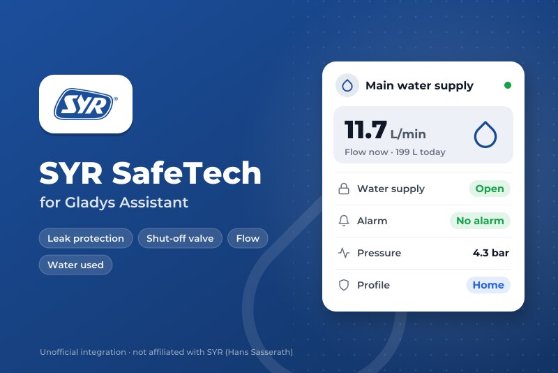
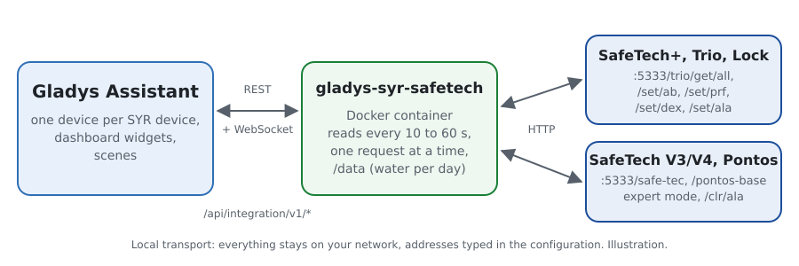
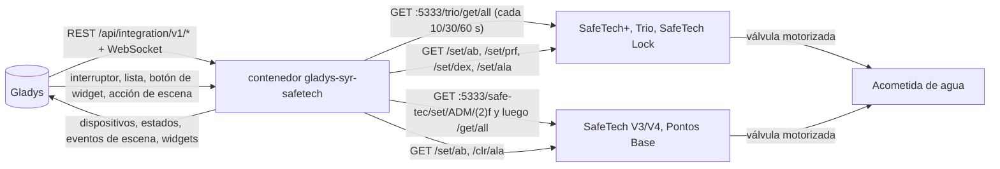
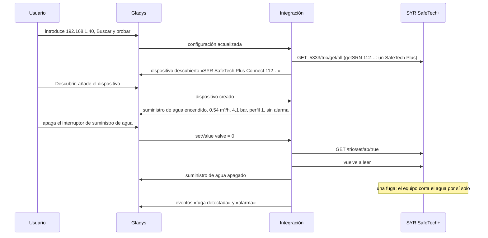

# Gladys SYR SafeTech

[English](README.md) · [Français](README.fr.md) · [Deutsch](README.de.md) · **Español**

[](LICENSE)
[](https://github.com/William-De71/gladys-syr-safetech/releases)
[](https://github.com/William-De71/gladys-syr-safetech/actions/workflows/release.yml)
[](https://gladysassistant.com)



Integración externa de [Gladys Assistant](https://gladysassistant.com) para los **equipos antifugas SYR**, las válvulas motorizadas instaladas en la acometida de agua que cortan el agua cuando corre demasiado tiempo o con demasiado caudal. Muestra en Gladys la válvula, las alarmas de fuga, el caudal, la presión, la temperatura y el agua consumida cada día, permite cortar el agua o volver a abrirla desde un interruptor, un widget o una escena, y dispara escenas cuando se detecta una fuga — solo en su red local.

Documentación de usuario: [English](docs/en.md) · [Français](docs/fr.md) · [Deutsch](docs/de.md) · [Español](docs/es.md).

No afiliada a SYR (Hans Sasserath). **Todavía no probada con un equipo real**: las peticiones y respuestas siguen la documentación comunitaria de la API local (alexhass/syr_connect, Apache-2.0, y ahornung/syr-safetech-connect-api, MIT; sin código tomado de ninguno).

## Funciones

- **SafeTech Connect** (V3, V4, actual), **SafeTech+**, **Trio DFR/LS**, **Trio LS**, **SafeTech Lock**, **TRIO Lock**, **Hansgrohe Pontos Base**, **RWC MultiSafe** y sus gemelos de otras marcas: direcciones introducidas en la configuración, la ruta de la API (`/trio`, `/safe-tec`, `/pontos-base`) y el modo experto de los firmwares antiguos los encuentra la integración; un equipo se reconoce por su número de serie, una nueva dirección IP lo conserva.
- **Un dispositivo por equipo SYR**: el suministro de agua como interruptor, detector de fugas, alarma en palabras, perfil de protección como lista, caudal, presión, temperatura del agua, contador, agua consumida hoy, última extracción y extracción en curso, batería.
- **6 disparadores de escena** (fuga detectada, alarma, alarma terminada, aviso, no responde, responde de nuevo), **4 acciones de escena** (elegir un perfil, prueba de microfuga, borrar la alarma, agua consumida) y **2 widgets** (resumen con botones, agua por día).
- Equipos leídos cada 10, 30 o 60 segundos, una petición cada vez.
- Solo local, sin cuenta, sin nube. Cuatro idiomas en todas partes: inglés, francés, alemán, español.

## Cómo funciona





De la dirección a una orden:



### Transporte

`transports: ["local"]`: la integración habla con los equipos por HTTP en el puerto 5333 de su red; **ningún dato sale de su casa**. Con un solo canal, no hay botón «preferir la conexión local» ni distintivo de transporte por dispositivo. Los equipos no se anuncian en la red: las direcciones se introducen. `/data/syr.json` (modo 0600) guarda, por equipo, su última dirección y ruta de API, sus valores, las funciones vistas, la primera lectura del contador de cada uno de los últimos 35 días y lo que saben los disparadores.

## Dispositivos y funciones

| Dispositivo | Funciones (categoría / tipo)                                                                                                                                                                                                                                                                                                                                                                                                                                                                                                                                                                   |
| ----------- | ---------------------------------------------------------------------------------------------------------------------------------------------------------------------------------------------------------------------------------------------------------------------------------------------------------------------------------------------------------------------------------------------------------------------------------------------------------------------------------------------------------------------------------------------------------------------------------------------- |
| Equipo SYR  | Suministro de agua (`switch` / `binary`, 1 = el agua pasa, modificable), fuga (`leak-sensor` / `binary`), alarma (`text` / `text`), perfil de protección (`text` / `select`, modificable, los perfiles del equipo como opciones), caudal (`water-valve` / `flow`, m³/h), presión (`pressure-sensor` / `decimal`, bar), temperatura del agua (`temperature-sensor` / `decimal`, °C), contador (`volume-sensor` / `decimal`, m³), agua consumida hoy, última extracción y en curso (`volume-sensor` / `decimal`, L), batería (`battery` / `integer`, %), batería baja (`battery-low` / `binary`) |

- Los identificadores externos se basan en el número de serie: `ext:…:syr:<número en minúsculas>`, funciones `…:<clave>`.
- La válvula se lee en el estado del motor (`getVLV`: 10 cerrada, 11 cerrándose, 20 abierta, 21 abriéndose) y se controla en el formato que indica el equipo (`true`/`false` en los recientes, `2`/`1` en los antiguos).
- El agua consumida hoy la calcula la integración: el contador en la primera lectura tras la medianoche (zona horaria de Gladys) y ahora.
- Una función aparece en cuanto se ha visto su valor (sin sensor de presión en un Trio DFR/LS, sin nivel de batería en un SafeTech, sin control de válvula en un Pontos Base): pulse **Actualizar** en la pantalla Descubrir si aparece una más tarde.
- Los estados se envían cuando cambian, y cada 30 minutos si no; un equipo inaccesible no envía nada (Gladys muestra sus valores como antiguos).

## Disparadores, acciones de escena y widgets


**Widgets**: Antifugas (un equipo, el primero por defecto: caudal actual, agua consumida hoy, presión, la válvula, la alarma, un aviso, la temperatura del agua, el perfil, la batería, la última lectura, y los botones «Cortar el agua» / «Abrir el agua», «Borrar la alarma» y «Prueba microfuga», que Gladys pide confirmar antes de mover la válvula) y Agua por día (hoy, la media diaria, el contador y un gráfico de barras de los últimos 14 días).

**Disparadores** (un evento por transición, nunca en la primera lectura, nunca como resultado de una acción; filtro: el equipo):

- **fuga detectada**: ha aparecido una alarma de fuga (volumen, duración o caudal máximo, microfuga, sensor de suelo); variables: dispositivo, nombre, código, alarma, fuga, agua cortada, mensaje;
- **alarma**: cualquier alarma, fallos incluidos; mismas variables;
- **alarma terminada**: la alarma ha desaparecido en el equipo o en su app (no cuando la borra Gladys);
- **aviso** (equipos recientes): corte de corriente, batería, aviso de fuga…; variables: código, aviso, mensaje;
- **no responde**: sin respuesta a 3 lecturas seguidas durante al menos un minuto; variables: dirección, lecturas fallidas;
- **responde de nuevo**: variable: minutos sin respuesta.

**Acciones**:

- **elegir un perfil**: por su número en la app SYR (1 a 8); salidas: nombre, número y nombre del perfil, `summary`;
- **prueba de microfuga**: la válvula se cierra unos 4 minutos, una fuga encontrada dispara una alarma; salida: `summary`;
- **borrar la alarma**: la válvula se queda como está; salidas: la alarma borrada, `summary`;
- **agua consumida**: hoy, ayer, contador, caudal actual (L/min), válvula abierta, `summary`.

Cortar o abrir el agua es la función **Suministro de agua**: un «controlar un dispositivo» en una escena, como cualquier interruptor. Los umbrales de presión o de caudal son condiciones de dispositivo de Gladys, con sus propios valores.

No se hace, a propósito: ningún cambio de los límites de fuga de los perfiles, de los ajustes del equipo o de su Wi-Fi, nada de nube SYR, ningún descalcificador (sal, regeneración).

Ejemplos:

- Cuando un detector de fugas Zigbee bajo el fregadero se moja → apagar el **Suministro de agua** y enviar un mensaje.
- Cuando se activa la alarma de la casa → **elegir un perfil** 2 («Ausente»); perfil 1 al desactivarla.
- Cuando **fuga detectada** → enviar `{{triggerEvent.data.message}}` y apagar la caldera.

## Requisitos

- Gladys Assistant **5.3.0** o posterior (widgets y escenas de las integraciones, palabras clave del catálogo): las instancias más antiguas no pueden instalar la integración.
- Un equipo SYR **con API local** (ni Safe-T+ ni descalcificador LEX, que solo hablan con la nube de SYR), configurado con la app SYR, en la misma red que Gladys.
- Su dirección IP (menú del equipo o router), fijada con una reserva DHCP.

### El ritmo del equipo

El controlador de la válvula también sirve su API: el cliente envía una petición cada vez, sin keep-alive, con un tiempo de espera de 10 segundos y una breve pausa entre peticiones. Una lectura es una petición (`/get/all`), más el modo experto cada 30 minutos en los firmwares antiguos. Una orden vuelve a leer el equipo enseguida. Una dirección que no es un equipo SYR se deja de lado 30 minutos (o hasta **Buscar y probar**).

## Instalación

- **Desde la tienda**: Integraciones → SYR SafeTech → Instalar.
- **Desde la URL del repositorio**: Integraciones → integración externa → `https://github.com/William-De71/gladys-syr-safetech`.
- **Modo desarrollador**: ejecute `npm start` con las variables que da Gladys (ver Desarrollo).

## Configuración

| Campo o botón                 | Por defecto | Función                                                                                                       |
| ----------------------------- | ----------- | ------------------------------------------------------------------------------------------------------------- |
| Direcciones de los equipos    | —           | Direcciones IP o nombres, separados por comas, con `:puerto` si no es el 5333; obligatorio                    |
| Lectura                       | 30 s        | 10 s, 30 s o 1 min                                                                                            |
| Idioma de los textos          | automático  | Nombres de funciones, alarmas, textos de escenas y errores (automático: el idioma del último widget mostrado) |
| Buscar y probar / Diagnóstico | —           | Lee los equipos y los ofrece, indica qué dirección falla; escribe el estado en los registros                  |

## Uso

1. Configure el equipo con la app SYR (Wi-Fi, perfiles) y anote su dirección IP.
2. En Gladys (Integraciones → SYR SafeTech → Configuración): introduzca la dirección; pulse **Buscar y probar**.
3. **Descubrir**, y luego añada el equipo.
4. Añada los widgets a un panel, cree escenas con las funciones, los disparadores y las acciones.

## Desarrollo

```bash
npm install
npm test                       # node --test, equipos SYR falsos, nunca la red
npm run lint                   # ESLint
npm run format:check           # Prettier
npx github:GladysAssistant/integration-store . --skip-image-check
scripts/build-cover.sh         # cover.jpg a partir de docs/assets/cover.svg
docs/illustrations/render.sh   # docs/assets/widgets.<idioma>.png
```

En local, el SDK lee `GLADYS_HOST_API_URL`, `GLADYS_INTEGRATION_TOKEN` y `GLADYS_INTEGRATION_SELECTOR` (que da Gladys en modo desarrollador), y la integración lee `TZ`. `DEBUG=gladys-integration-sdk` muestra los registros del SDK.

Las pruebas cubren el cliente HTTP (una petición cada vez, los errores), las tres formas de respuesta (tipos JSON nativos, textos con unidades, modo experto), las órdenes y los rechazos, el agua por día, los dispositivos (los campos que exige la pantalla Descubrir, los pares categoría / tipo del núcleo), los disparadores, los widgets (`validateWidgetContent`), el manifiesto, los cuatro idiomas, el script de publicación, y toda la integración frente al Gladys falso del SDK y a equipos falsos. `test/structure.test.js` congela cada clave que guardan los usuarios.

## Proceso de publicación


Cada fusión en `main` lanza la CI y calcula la versión a partir de los [Conventional Commits](https://www.conventionalcommits.org/es/) desde la última etiqueta: `feat` → menor, `fix` / `perf` → parche, `!` o `BREAKING CHANGE` → mayor (una menor antes de 1.0.0); `docs`, `chore`, `ci`, `test`, `style`, `refactor`, `build` solos no publican nada. Se genera la sección del changelog, se sube la etiqueta, se construye la imagen multiarquitectura, luego `main` recibe el commit de publicación, se crea la GitHub Release y un último job comprueba la imagen pública, el validador de la tienda y el topic.

- El título de la pull request se convierte en el commit squash y luego en la línea del changelog: escríbalo en inglés, para el usuario (`pr-title.yml` lo comprueba). No edite nunca `CHANGELOG.md` a mano.
- La 1.0.0 es una decisión: Actions → Release → Run workflow con `release-as: 1.0.0`. `dry-run` muestra la versión y las notas sin publicar nada.
- **Rama protegida**: la publicación sube su commit a `main` con `GITHUB_TOKEN`. El ruleset `protect-main` (sin borrado, sin force-push) lo deja pasar; una regla más estricta (pull request obligatoria, status checks) necesitaría GitHub Actions en su lista de excepciones, o una GitHub App.
- Tras la primera publicación, haga público el paquete de `ghcr.io` (Package settings → Change visibility), o Gladys no podrá descargarlo.

## Solución de problemas

Vea [docs/es.md](docs/es.md#solución-de-problemas). Informe de los problemas con las versiones de Gladys, de la integración y del firmware del equipo, su modelo, el mensaje de **Buscar y probar** y el resultado de **Diagnóstico** (en los registros de la integración).

## Contribuir

Las issues y pull requests son bienvenidas. Ejecute `npm run format:check && npm run lint && npm test` antes de abrir una pull request, y mantenga sin cambios todos los identificadores externos y claves guardadas (ver [CLAUDE.md](CLAUDE.md)). Las respuestas de `/get/all` capturadas en un equipo real (con el número de serie y las direcciones MAC cambiados) son especialmente bienvenidas como datos de prueba.

## Seguridad

Vea [SECURITY.md](SECURITY.md): informe de las vulnerabilidades en privado. La API local de los equipos SYR no tiene contraseña: cualquiera en su red ya puede abrir o cerrar la válvula, así que manténgalos en una red de confianza. `/data/syr.json` se escribe en modo 0600.

## Capturas pendientes

Las imágenes de arriba son ilustraciones, no capturas de pantalla. Las capturas reales irán en `docs/assets/screenshots/` (PNG, 1280 × 800): `configuration.png`, `discovery.png` (un equipo SYR ofrecido), `device.png` (el dispositivo con su interruptor de suministro de agua y su lista de perfiles), `scene-leak.png` (una escena con «fuga detectada»), `dashboard.png` (los dos widgets con un equipo real).

## Licencia

[Licencia Apache 2.0](LICENSE) — vea también [NOTICE](NOTICE). SYR, SafeTech y Pontos son marcas de sus propietarios. Gracias a la documentación y al SDK de Gladys, y a alexhass/syr_connect y ahornung/syr-safetech-connect-api por documentar la API local (leídos solo por los hechos, sin usar código).
