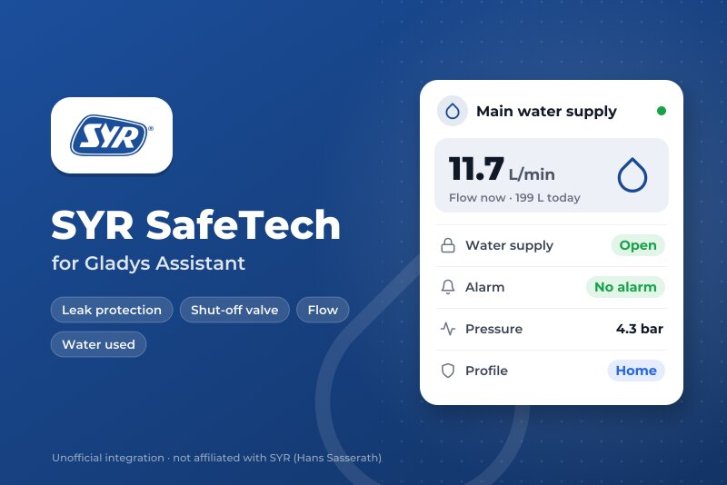
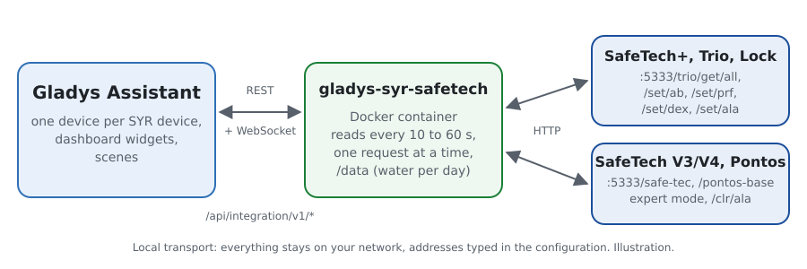
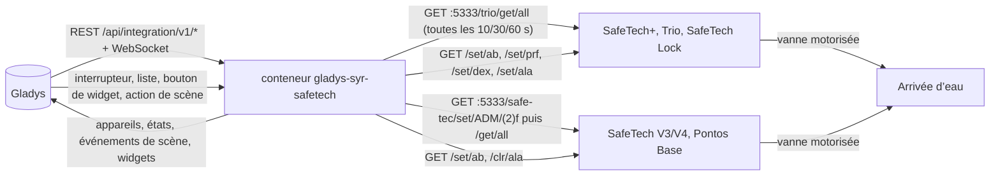
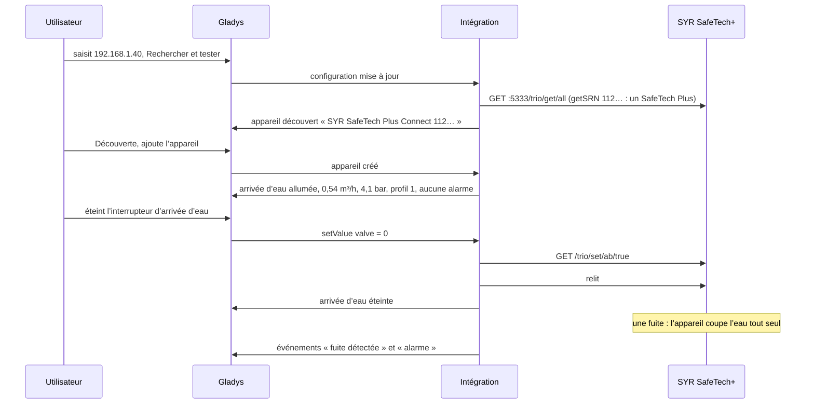
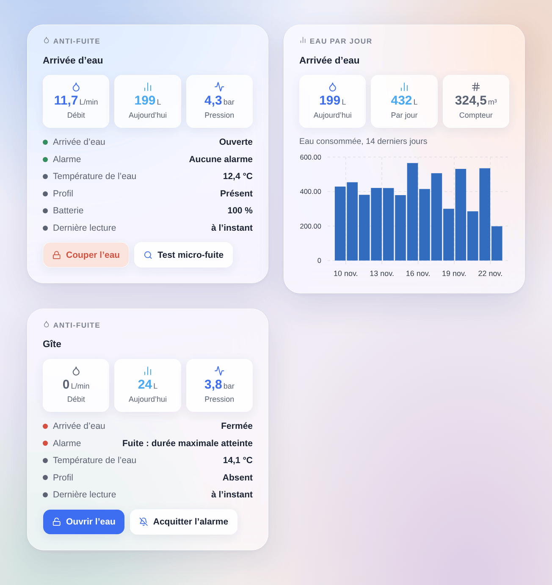

# Gladys SYR SafeTech

[English](README.md) · **Français** · [Deutsch](README.de.md) · [Español](README.es.md)

[](LICENSE)
[](https://github.com/William-De71/gladys-syr-safetech/releases)
[](https://github.com/William-De71/gladys-syr-safetech/actions/workflows/release.yml)
[](https://gladysassistant.com)



Intégration externe de [Gladys Assistant](https://gladysassistant.com) pour les **protections anti-fuite SYR**, les vannes motorisées posées sur l’arrivée d’eau qui coupent l’eau quand elle coule trop longtemps ou trop fort. Elle affiche dans Gladys la vanne, les alarmes de fuite, le débit, la pression, la température et l’eau consommée chaque jour, permet de couper l’eau ou de la rouvrir depuis un interrupteur, un widget ou une scène, et déclenche des scènes quand une fuite est détectée — sur votre réseau local uniquement.

Documentation utilisateur : [English](docs/en.md) · [Français](docs/fr.md) · [Deutsch](docs/de.md) · [Español](docs/es.md).

Non affiliée à SYR (Hans Sasserath). **Pas encore testée sur un vrai appareil** : les requêtes et les réponses suivent la documentation communautaire de l’API locale (alexhass/syr_connect, Apache-2.0, et ahornung/syr-safetech-connect-api, MIT ; aucun code repris).

## Fonctionnalités

- **SafeTech Connect** (V3, V4, actuel), **SafeTech+**, **Trio DFR/LS**, **Trio LS**, **SafeTech Lock**, **TRIO Lock**, **Hansgrohe Pontos Base**, **RWC MultiSafe** et leurs jumeaux d’autres marques : adresses saisies dans la configuration, le chemin de l’API (`/trio`, `/safe-tec`, `/pontos-base`) et le mode expert des anciens firmwares trouvés par l’intégration ; un appareil est reconnu à son numéro de série, une nouvelle adresse IP le garde.
- **Un appareil par appareil SYR** : l’arrivée d’eau en interrupteur, détecteur de fuite, alarme en toutes lettres, profil de protection en liste de choix, débit, pression, température de l’eau, compteur, eau consommée aujourd’hui, dernier puisage et puisage en cours, batterie.
- **6 déclencheurs de scène** (fuite détectée, alarme, alarme terminée, avertissement, ne répond plus, répond à nouveau), **4 actions de scène** (choisir un profil, test de micro-fuite, acquitter l’alarme, eau consommée) et **2 widgets** (vue d’ensemble avec boutons, eau par jour).
- Appareils lus toutes les 10, 30 ou 60 secondes, une requête à la fois.
- Local uniquement, sans compte, sans cloud. Quatre langues partout : anglais, français, allemand, espagnol.

## Fonctionnement





De l’adresse à une commande :



### Transport

`transports: ["local"]` : l’intégration dialogue avec les appareils en HTTP sur le port 5333 de votre réseau ; **aucune donnée ne sort de chez vous**. Avec un seul canal, il n’y a ni bouton « préférer la connexion locale » ni badge de transport par appareil. Les appareils ne s’annoncent pas sur le réseau : les adresses sont saisies. `/data/syr.json` (mode 0600) garde, par appareil, sa dernière adresse et son chemin d’API, ses valeurs, les fonctionnalités vues, le premier relevé du compteur de chacun des 35 derniers jours et ce que savent les déclencheurs.

## Appareils et fonctionnalités

| Appareil     | Fonctionnalités (catégorie / type)                                                                                                                                                                                                                                                                                                                                                                                                                                                                                                                                                                       |
| ------------ | -------------------------------------------------------------------------------------------------------------------------------------------------------------------------------------------------------------------------------------------------------------------------------------------------------------------------------------------------------------------------------------------------------------------------------------------------------------------------------------------------------------------------------------------------------------------------------------------------------- |
| Appareil SYR | Arrivée d’eau (`switch` / `binary`, 1 = l’eau passe, modifiable), fuite (`leak-sensor` / `binary`), alarme (`text` / `text`), profil de protection (`text` / `select`, modifiable, les profils de l’appareil en options), débit (`water-valve` / `flow`, m³/h), pression (`pressure-sensor` / `decimal`, bar), température de l’eau (`temperature-sensor` / `decimal`, °C), compteur (`volume-sensor` / `decimal`, m³), eau consommée aujourd’hui, dernier puisage et puisage en cours (`volume-sensor` / `decimal`, L), batterie (`battery` / `integer`, %), batterie faible (`battery-low` / `binary`) |

- Les identifiants externes reposent sur le numéro de série : `ext:…:syr:<numéro en minuscules>`, fonctionnalités `…:<clé>`.
- La vanne est lue sur l’état du moteur (`getVLV` : 10 fermée, 11 en fermeture, 20 ouverte, 21 en ouverture) et pilotée au format que remonte l’appareil (`true`/`false` sur les récents, `2`/`1` sur les anciens).
- L’eau consommée aujourd’hui est calculée par l’intégration : le compteur à la première lecture après minuit (fuseau horaire de Gladys) et maintenant.
- Une fonctionnalité apparaît dès que sa valeur a été vue (pas de capteur de pression sur un Trio DFR/LS, pas de niveau de batterie sur un SafeTech, pas de pilotage de vanne sur un Pontos Base) : appuyez sur **Mettre à jour** dans l’écran Découverte si une apparaît plus tard.
- Les états sont envoyés quand ils changent, et toutes les 30 minutes sinon ; un appareil injoignable n’envoie rien (Gladys affiche ses valeurs comme anciennes).

## Déclencheurs, actions de scène et widgets



**Widgets** : Anti-fuite (un appareil, le premier par défaut : débit actuel, eau consommée aujourd’hui, pression, la vanne, l’alarme, un avertissement, la température de l’eau, le profil, la batterie, la dernière lecture, et les boutons « Couper l’eau » / « Ouvrir l’eau », « Acquitter l’alarme » et « Test micro-fuite », que Gladys fait confirmer avant que la vanne bouge) et Eau par jour (aujourd’hui, la moyenne par jour, le compteur et un graphique en barres des 14 derniers jours).

**Déclencheurs** (un événement par transition, jamais à la première lecture, jamais à la suite d’une action ; filtre : l’appareil) :

- **fuite détectée** : une alarme de fuite est apparue (volume, durée ou débit maximal, micro-fuite, capteur de sol) ; variables : appareil, nom, code, alarme, fuite, eau coupée, message ;
- **alarme** : n’importe quelle alarme, défauts compris ; mêmes variables ;
- **alarme terminée** : l’alarme a disparu sur l’appareil ou dans son appli (pas quand Gladys l’acquitte) ;
- **avertissement** (appareils récents) : coupure de courant, batterie, alerte de fuite… ; variables : code, avertissement, message ;
- **ne répond plus** : pas de réponse à 3 lectures de suite pendant au moins une minute ; variables : adresse, lectures manquées ;
- **répond à nouveau** : variable : minutes sans réponse.

**Actions** :

- **choisir un profil** : par son numéro dans l’appli SYR (1 à 8) ; sorties : nom, numéro et nom du profil, `summary` ;
- **test de micro-fuite** : la vanne se ferme environ 4 minutes, une fuite trouvée déclenche une alarme ; sortie : `summary` ;
- **acquitter l’alarme** : la vanne reste telle quelle ; sorties : l’alarme acquittée, `summary` ;
- **eau consommée** : aujourd’hui, hier, compteur, débit actuel (L/min), vanne ouverte, `summary`.

Couper ou rouvrir l’eau, c’est la fonctionnalité **Arrivée d’eau** : un « contrôler un appareil » dans une scène, comme tout interrupteur. Les seuils de pression ou de débit sont des conditions d’appareil de Gladys, avec vos propres valeurs.

Volontairement pas fait : pas de modification des limites de fuite des profils, des réglages de l’appareil ou de son Wi-Fi, pas de cloud SYR, pas d’adoucisseur (sel, régénération).

Exemples :

- Quand un détecteur de fuite Zigbee sous l’évier est mouillé → éteindre l’**Arrivée d’eau** et envoyer un message.
- Quand l’alarme de la maison est armée → **choisir un profil** 2 (« Absent ») ; profil 1 au désarmement.
- Quand **fuite détectée** → envoyer `{{triggerEvent.data.message}}` et éteindre la chaudière.

## Prérequis

- Gladys Assistant **5.3.0** ou plus récent (widgets et scènes des intégrations, mots-clés du catalogue) : les instances plus anciennes ne peuvent pas installer l’intégration.
- Un appareil SYR **à API locale** (ni Safe-T+ ni adoucisseur LEX, qui ne parlent qu’au cloud SYR), installé avec l’appli SYR, sur le même réseau que Gladys.
- Son adresse IP (menu de l’appareil ou box), fixée par une réservation DHCP.

### Le rythme de l’appareil

Le contrôleur de la vanne sert aussi son API : le client envoie une requête à la fois, sans keep-alive, avec un délai de 10 secondes et une courte pause entre deux requêtes. Une lecture, c’est une requête (`/get/all`), plus le mode expert toutes les 30 minutes sur les anciens firmwares. Une commande relit l’appareil aussitôt. Une adresse qui n’est pas un appareil SYR est laissée de côté 30 minutes (ou jusqu’à **Rechercher et tester**).

## Installation

- **Depuis le store** : Intégrations → SYR SafeTech → Installer.
- **Depuis l’URL du dépôt** : Intégrations → intégration externe → `https://github.com/William-De71/gladys-syr-safetech`.
- **Mode développeur** : lancez `npm start` avec les variables fournies par Gladys (voir Développement).

## Configuration

| Champ ou bouton                   | Défaut      | Rôle                                                                                                                |
| --------------------------------- | ----------- | ------------------------------------------------------------------------------------------------------------------- |
| Adresses des appareils            | —           | Adresses IP ou noms, séparés par des virgules, avec `:port` s’il n’est pas 5333 ; obligatoire                       |
| Lecture                           | 30 s        | 10 s, 30 s ou 1 min                                                                                                 |
| Langue des textes                 | automatique | Noms des fonctionnalités, alarmes, textes des scènes et erreurs (automatique : la langue du dernier widget affiché) |
| Rechercher et tester / Diagnostic | —           | Lit les appareils et les propose, dit quelle adresse échoue ; écrit l’état dans les journaux                        |

## Utilisation

1. Installez l’appareil avec l’appli SYR (Wi-Fi, profils) et notez son adresse IP.
2. Dans Gladys (Intégrations → SYR SafeTech → Configuration) : saisissez l’adresse ; appuyez sur **Rechercher et tester**.
3. **Découverte**, puis ajoutez l’appareil.
4. Ajoutez les widgets à un tableau de bord, créez des scènes avec les fonctionnalités, les déclencheurs et les actions.

## Développement

```bash
npm install
npm test                       # node --test, faux appareils SYR, jamais le réseau
npm run lint                   # ESLint
npm run format:check           # Prettier
npx github:GladysAssistant/integration-store . --skip-image-check
scripts/build-cover.sh         # cover.jpg depuis docs/assets/cover.svg
docs/illustrations/render.sh   # docs/assets/widgets.<langue>.png
```

En local, le SDK lit `GLADYS_HOST_API_URL`, `GLADYS_INTEGRATION_TOKEN` et `GLADYS_INTEGRATION_SELECTOR` (fournies par Gladys en mode développeur), et l’intégration lit `TZ`. `DEBUG=gladys-integration-sdk` affiche les journaux du SDK.

Les tests couvrent le client HTTP (une requête à la fois, les erreurs), les trois formes de réponses (types JSON natifs, textes avec unités, mode expert), les commandes et les refus, l’eau par jour, les appareils (les champs qu’exige l’écran Découverte, les couples catégorie / type du cœur), les déclencheurs, les widgets (`validateWidgetContent`), le manifeste, les quatre langues, le script de release, et toute l’intégration face au faux Gladys du SDK et à de faux appareils. `test/structure.test.js` fige chaque clé que les utilisateurs enregistrent.

## Processus de release


Chaque fusion sur `main` lance la CI, puis calcule la version à partir des [Conventional Commits](https://www.conventionalcommits.org/fr/) depuis le dernier tag : `feat` → mineure, `fix` / `perf` → correctif, `!` ou `BREAKING CHANGE` → majeure (une mineure avant 1.0.0) ; `docs`, `chore`, `ci`, `test`, `style`, `refactor`, `build` seuls ne publient rien. La section du changelog est générée, le tag poussé, l’image multi-architecture construite, puis `main` reçoit le commit de release, la GitHub Release est créée et un dernier job vérifie l’image publique, le validateur du store et le topic.

- Le titre de la pull request devient le commit squash, puis la ligne du changelog : écrivez-le en anglais, pour l’utilisateur (`pr-title.yml` le vérifie). Ne modifiez jamais `CHANGELOG.md` à la main.
- La 1.0.0 est une décision : Actions → Release → Run workflow avec `release-as: 1.0.0`. `dry-run` affiche la version et les notes sans rien publier.
- **Branche protégée** : des rulesets imposent une pull request sur `main` et verrouillent les tags `v*` ; seuls le mainteneur et les deploy keys passent. La release pousse avec la deploy key de l’environnement `release` (secret `RELEASE_DEPLOY_KEY`, `main` seulement) : un run lancé depuis une autre branche ne l’obtient jamais. `build.yml` et `github-release.yml` ne démarrent pas sur un tag : la release les appelle, ou lancez-les à la main (Actions → Run workflow, avec `version` pour l’image) pour terminer une release.
- Après la première release, rendez public le package `ghcr.io` (Package settings → Change visibility), sinon Gladys ne peut pas le télécharger.

## Dépannage

Voir [docs/fr.md](docs/fr.md#dépannage). Signalez un problème avec les versions de Gladys, de l’intégration et du firmware de l’appareil, son modèle, le message de **Rechercher et tester** et le résultat de **Diagnostic** (dans les journaux de l’intégration).

## Contribuer

Issues et pull requests bienvenues. Lancez `npm run format:check && npm run lint && npm test` avant d’ouvrir une pull request, et gardez inchangés tous les identifiants externes et toutes les clés enregistrées (voir [CLAUDE.md](CLAUDE.md)). Les réponses de `/get/all` relevées sur un vrai appareil (numéro de série et adresses MAC changés) sont particulièrement bienvenues comme jeux de test.

## Sécurité

Voir [SECURITY.md](SECURITY.md) : signalez les vulnérabilités en privé. L’API locale des appareils SYR n’a pas de mot de passe : n’importe qui sur votre réseau peut déjà ouvrir ou fermer la vanne, gardez-les donc sur un réseau de confiance. `/data/syr.json` est écrit en mode 0600.

## Captures à venir

Les images ci-dessus sont des illustrations, pas des captures d’écran. Les vraies captures iront dans `docs/assets/screenshots/` (PNG, 1280 × 800) : `configuration.png`, `discovery.png` (un appareil SYR proposé), `device.png` (l’appareil avec son interrupteur d’arrivée d’eau et sa liste de profils), `scene-leak.png` (une scène sur « fuite détectée »), `dashboard.png` (les deux widgets avec un vrai appareil).

## Licence

[Licence Apache 2.0](LICENSE) — voir aussi [NOTICE](NOTICE). SYR, SafeTech et Pontos sont des marques de leurs propriétaires. Merci à la documentation et au SDK de Gladys, ainsi qu’à alexhass/syr_connect et ahornung/syr-safetech-connect-api pour avoir documenté l’API locale (lus pour les faits seulement, aucun code utilisé).
