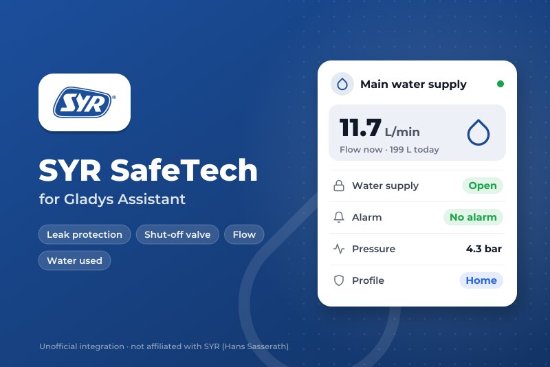
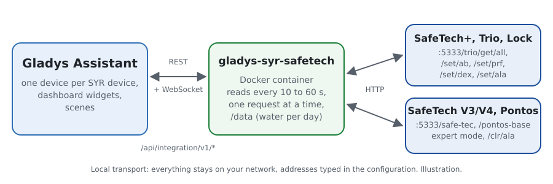
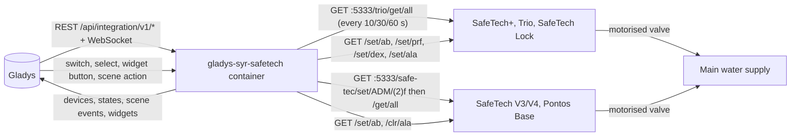
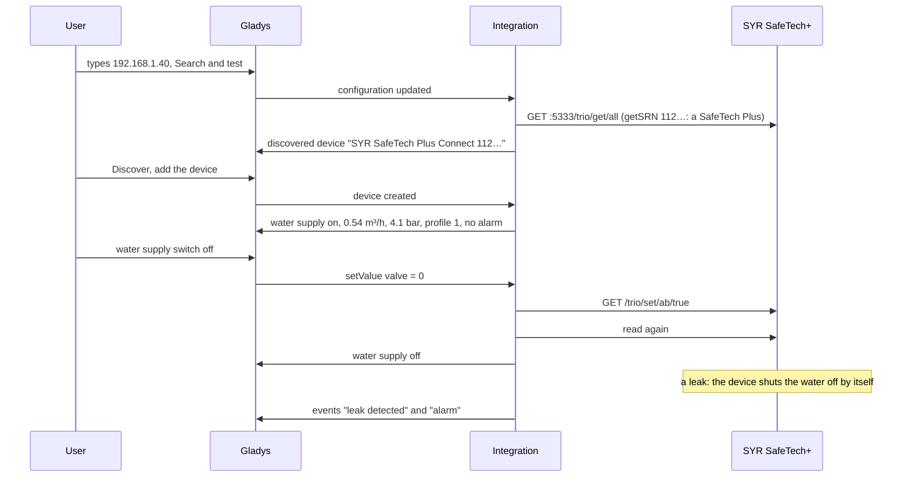
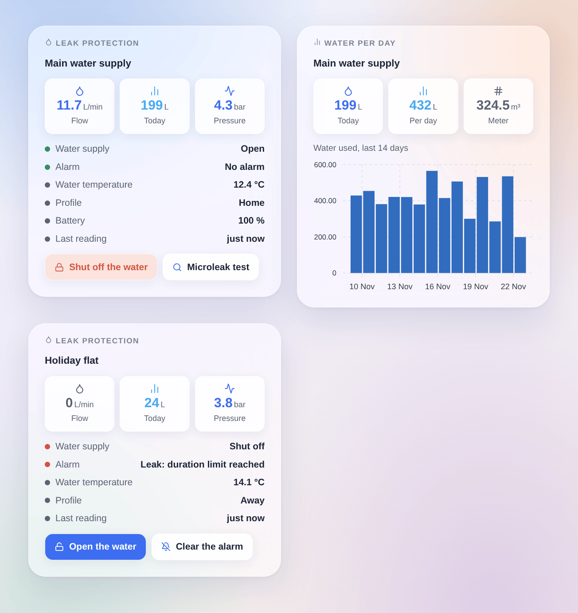

# Gladys SYR SafeTech

**English** · [Français](README.fr.md) · [Deutsch](README.de.md) · [Español](README.es.md)

[](LICENSE)
[](https://github.com/William-De71/gladys-syr-safetech/releases)
[](https://github.com/William-De71/gladys-syr-safetech/actions/workflows/release.yml)
[](https://gladysassistant.com)



[Gladys Assistant](https://gladysassistant.com) external integration for the **SYR leak protection devices**, the motorised valves on the main water supply that shut the water off when it flows too long or too much. It shows the valve, the leak alarms, the flow, pressure, temperature and the water used each day in Gladys, lets you shut the water off or open it again from a switch, a widget or a scene, and fires scenes when a leak is detected — on your local network only.

User documentation: [English](docs/en.md) · [Français](docs/fr.md) · [Deutsch](docs/de.md) · [Español](docs/es.md).

Not affiliated with SYR (Hans Sasserath). **Not tested with a real device yet**: the requests and answers follow the community documentation of the local API (alexhass/syr_connect, Apache-2.0, and ahornung/syr-safetech-connect-api, MIT; no code taken from either).

## Features

- **SafeTech Connect** (V3, V4, current), **SafeTech+**, **Trio DFR/LS**, **Trio LS**, **SafeTech Lock**, **TRIO Lock**, **Hansgrohe Pontos Base**, **RWC MultiSafe** and their twins of other brands: addresses typed in the configuration, the API path (`/trio`, `/safe-tec`, `/pontos-base`) and the expert mode of the older firmwares found by the integration; a device is known by its serial number, so a new IP address keeps it.
- **One device per SYR device**: the water supply as a switch, leak sensor, alarm in words, leak protection profile as a select, flow, pressure, water temperature, meter, water used today, last and current water draw, battery.
- **6 scene triggers** (leak detected, alarm, alarm over, warning, not answering, answering again), **4 scene actions** (select a profile, microleak test, clear the alarm, water used) and **2 dashboard widgets** (overview with buttons, water per day).
- Devices read every 10, 30 or 60 seconds, one request at a time.
- Local only, no account, no cloud. Four languages everywhere: English, French, German, Spanish.

## How it works





From the address to a command:



### Transport

`transports: ["local"]`: the integration talks to the devices over HTTP on port 5333 of your network; **no data leaves your home**. With a single channel, there is no "prefer local connection" button nor per-device transport badge. The devices do not announce themselves on the network: the addresses are typed. `/data/syr.json` (mode 0600) keeps, per device, its last address and API path, its values, the features seen, the first meter reading of each of the last 35 days, and what the triggers know.

## Devices and features

| Device     | Features (category / type)                                                                                                                                                                                                                                                                                                                                                                                                                                                                                                                                         |
| ---------- | ------------------------------------------------------------------------------------------------------------------------------------------------------------------------------------------------------------------------------------------------------------------------------------------------------------------------------------------------------------------------------------------------------------------------------------------------------------------------------------------------------------------------------------------------------------------ |
| SYR device | Water supply (`switch` / `binary`, 1 = water flows, writable), leak (`leak-sensor` / `binary`), alarm (`text` / `text`), leak protection profile (`text` / `select`, writable, the profiles of the device as options), flow (`water-valve` / `flow`, m³/h), pressure (`pressure-sensor` / `decimal`, bar), water temperature (`temperature-sensor` / `decimal`, °C), meter (`volume-sensor` / `decimal`, m³), water used today, last and current draw (`volume-sensor` / `decimal`, L), battery (`battery` / `integer`, %), battery low (`battery-low` / `binary`) |

- External ids rest on the serial number: `ext:…:syr:<serial in lower case>`, features `…:<key>`.
- The valve is read from the motor state (`getVLV`: 10 closed, 11 closing, 20 open, 21 opening) and driven in the format the device reports (`true`/`false` on the newer ones, `2`/`1` on the older ones).
- The water used today is worked out by the integration: the meter at the first reading after midnight (timezone of Gladys) and now.
- A feature appears once its value was seen (no pressure sensor on a Trio DFR/LS, no battery level on a SafeTech, no valve control on a Pontos Base): press **Update** on the Discover screen if one appears later.
- The states are sent when they change, and every 30 minutes otherwise; an unreachable device sends nothing (Gladys shows its values outdated).

## Scene triggers, actions and widgets



**Widgets**: Leak protection (one device, the first one by default: flow now, water used today, pressure, the valve, the alarm, a warning, the water temperature, the profile, the battery, the last reading, and buttons "Shut off the water" / "Open the water", "Clear the alarm" and "Microleak test", which Gladys confirms before the valve moves) and Water per day (today, the average per day, the meter and a bar chart of the last 14 days).

**Triggers** (one event per transition, never at the first reading, never as the result of an action; filter: the device):

- **leak detected**: a leak alarm came up (volume, duration or flow limit, microleak, floor sensor); variables: device, name, code, alarm, leak, water shut off, message;
- **alarm**: any alarm came up, faults included; same variables;
- **alarm over**: the alarm went away on the device or in its app (not when Gladys clears it);
- **warning** (newer devices): power cut, battery, leak warning…; variables: code, warning, message;
- **not answering**: no answer to 3 readings in a row for at least a minute; variables: address, readings missed;
- **answering again**: variable: minutes without answer.

**Actions**:

- **select a profile**: by its number in the SYR app (1 to 8); outputs: name, number and name of the profile, `summary`;
- **microleak test**: the valve closes about 4 minutes, a leak found raises an alarm; output: `summary`;
- **clear the alarm**: the valve stays as it is; outputs: the cleared alarm, `summary`;
- **water used**: today, yesterday, meter, flow now (L/min), valve open, `summary`.

Shutting the water off or opening it is the **Water supply** feature: a "set value" in a scene, like any switch. Pressure or flow thresholds are device conditions of Gladys, with your own values.

Not done, on purpose: no change of the leak limits of the profiles, of the device settings or of its Wi-Fi, no SYR cloud, no water softener (salt, regeneration).

Examples:

- When a Zigbee leak sensor under the sink gets wet → turn the **Water supply** off and send a message.
- When the house alarm is armed → **select a profile** 2 ("Away"); profile 1 when it is disarmed.
- When **leak detected** → send `{{triggerEvent.data.message}}` and switch the boiler off.

## Requirements

- Gladys Assistant **5.3.0** or later (widgets and scenes of integrations, catalog keywords): older instances cannot install the integration.
- A SYR device **with a local API** (not a Safe-T+ nor a LEX softener, which only talk to the SYR cloud), set up with the SYR app, on the same network as Gladys.
- Its IP address (in the device menu or in your box), fixed with a DHCP reservation.

### The pace of the device

The controller of the valve also serves its API: the client sends one request at a time, without keep-alive, with a 10-second timeout and a short pause between requests. A round is one request (`/get/all`), plus the expert mode every 30 minutes on the older firmwares. A command reads the device again at once. An address that is no SYR device is left alone 30 minutes (or until **Search and test**).

## Installation

- **From the store**: Integrations → SYR SafeTech → Install.
- **From the repository URL**: Integrations → external integration → `https://github.com/William-De71/gladys-syr-safetech`.
- **Developer mode**: run `npm start` with the variables given by Gladys (see Development).

## Configuration

| Field or button              | Default   | Meaning                                                                                          |
| ---------------------------- | --------- | ------------------------------------------------------------------------------------------------ |
| Device addresses             | —         | IP addresses or names, separated by commas, with `:port` if it is not 5333; required             |
| Reading                      | 30 s      | 10 s, 30 s or 1 min                                                                              |
| Language of the texts        | automatic | Feature names, alarms, scene texts and errors (automatic: the language of the last widget shown) |
| Search and test / Diagnostic | —         | Reads the devices and offers them, says which address fails; writes the state in the logs        |

## Usage

1. Set up the device with the SYR app (Wi-Fi, profiles) and note its IP address.
2. In Gladys (Integrations → SYR SafeTech → Configuration): type the address; press **Search and test**.
3. **Discover**, then add the device.
4. Add the widgets to a dashboard, build scenes with the features, the triggers and the actions.

## Development

```bash
npm install
npm test                       # node --test, fake SYR devices, never the network
npm run lint                   # ESLint
npm run format:check           # Prettier
npx github:GladysAssistant/integration-store . --skip-image-check
scripts/build-cover.sh         # cover.jpg from docs/assets/cover.svg
docs/illustrations/render.sh   # docs/assets/widgets.<lang>.png
```

Locally, the SDK reads `GLADYS_HOST_API_URL`, `GLADYS_INTEGRATION_TOKEN` and `GLADYS_INTEGRATION_SELECTOR` (given by Gladys in developer mode), and the integration reads `TZ`. `DEBUG=gladys-integration-sdk` shows the SDK logs.

The tests cover the HTTP client (one request at a time, the errors), the three shapes of answers (native JSON types, strings with units, the expert mode), the commands and refusals, the water per day, the devices (the fields the Discovery screen requires, the category / type pairs of the core), the triggers, the widgets (`validateWidgetContent`), the manifest, the four languages, the release script, and the whole integration against the fake Gladys of the SDK and fake devices. `test/structure.test.js` freezes every key users store.

## Release process


Every merge on `main` runs the CI, then computes the version from the [Conventional Commits](https://www.conventionalcommits.org/) since the last tag: `feat` → minor, `fix` / `perf` → patch, `!` or `BREAKING CHANGE` → major (a minor below 1.0.0); `docs`, `chore`, `ci`, `test`, `style`, `refactor`, `build` alone publish nothing. The changelog section is generated, the tag pushed, the multi-architecture image built, then `main` receives the release commit, the GitHub Release is created and a last job checks the public image, the store validator and the topic.

- The pull request title becomes the squash commit, then the changelog line: write it in English, for the user (`pr-title.yml` checks it). Never edit `CHANGELOG.md` by hand.
- 1.0.0 is a decision: Actions → Release → Run workflow with `release-as: 1.0.0`. `dry-run` shows the version and the notes without publishing.
- **Protected branch**: rulesets require a pull request on `main` and lock the `v*` tags; only the maintainer and deploy keys get through. The release pushes with the deploy key of the `release` environment (secret `RELEASE_DEPLOY_KEY`, `main` only): a run from another branch never gets it. `build.yml` and `github-release.yml` do not start on a tag: the release calls them, or run them by hand (Actions → Run workflow, with `version` for the image) to finish a release.
- After the first release, make the `ghcr.io` package public (Package settings → Change visibility), or Gladys cannot pull it.

## Troubleshooting

See [docs/en.md](docs/en.md#troubleshooting). Report issues with the versions of Gladys, of the integration and of the device firmware, the model of the device, the message of **Search and test** and the result of **Diagnostic** (in the logs of the integration).

## Contributing

Issues and pull requests are welcome. Run `npm run format:check && npm run lint && npm test` before opening a pull request, and keep every external id and stored key unchanged (see [CLAUDE.md](CLAUDE.md)). Answers of `/get/all` captured from a real device (serial number and MAC addresses changed) are especially welcome as test fixtures.

## Security

See [SECURITY.md](SECURITY.md): report vulnerabilities privately. The local API of the SYR devices has no password: anyone on your network can already open or close the valve, so keep them on a trusted network. `/data/syr.json` is written with mode 0600.

## Screenshots to come

The images above are illustrations, not screenshots. Real screenshots will go in `docs/assets/screenshots/` (PNG, 1280 × 800): `configuration.png`, `discovery.png` (a SYR device offered), `device.png` (the device with its water supply switch and profile select), `scene-leak.png` (a scene on "leak detected"), `dashboard.png` (the two widgets with a real device).

## License

[Apache License 2.0](LICENSE) — see also [NOTICE](NOTICE). SYR, SafeTech and Pontos are trademarks of their owners. Thanks to the Gladys documentation and SDK, and to alexhass/syr_connect and ahornung/syr-safetech-connect-api for documenting the local API (read for the facts only, no code used).
