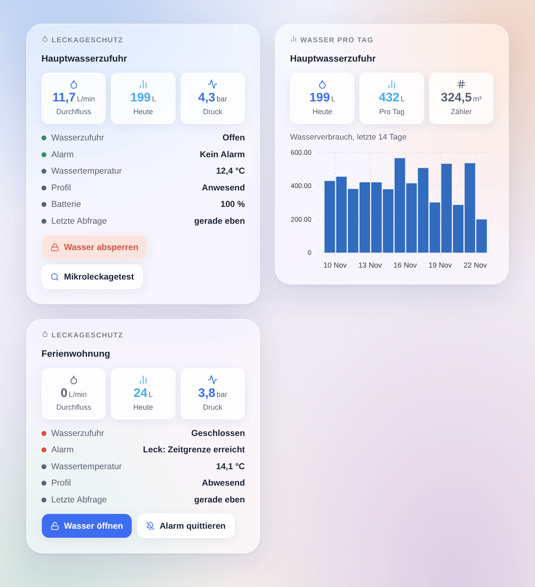

# SYR SafeTech

## Überblick

Diese Integration bringt deinen **SYR-Leckageschutz** über das lokale Netzwerk in Gladys: das Absperrventil deiner Hauswasserzufuhr, seine Leckalarme, Durchfluss, Druck und Temperatur des Wassers, den täglichen Wasserverbrauch und seine Schutzprofile. Du kannst das Wasser aus Gladys absperren und es von einer Szene erledigen lassen, wenn ein Wassermelder nass wird.

Sie spricht mit der **lokalen API** des Geräts (Port 5333): keine Cloud, kein SYR-Konto, nichts verlässt dein Zuhause. Sie funktioniert mit:

- SYR SafeTech Connect (V3, V4 und dem aktuellen Modell), SafeTech+ Connect, Trio DFR/LS Connect, Trio LS, SafeTech Lock und TRIO Lock Connect;
- Hansgrohe Pontos Base, RWC MultiSafe und denselben Geräten anderer Marken (CONEL, Sanibel, DITECH, TAKE, concept, Optima); vermutlich auch dem „Wasserwächter“ von POLYGONVATRO (gleiche Firmware, nicht bestätigt).

Die älteren Safe-T+ und die LEX-Enthärtungsanlagen haben keine lokale API: Sie sprechen nur mit der SYR-Cloud, die diese Integration nicht nutzt.

Diese Integration ist nicht mit SYR (Hans Sasserath) verbunden. Sie wurde nach der Community-Dokumentation der lokalen API geschrieben und **wurde noch nicht mit einem echten Gerät getestet**: Deine Rückmeldungen sind willkommen.

## Voraussetzungen

- Gladys Assistant 5.3.0 oder neuer.
- Das SYR-Gerät mit deinem Netzwerk verbunden (WLAN oder Ethernet) und vom Gladys-Server über Port 5333 erreichbar.
- Seine IP-Adresse: im Menü des Geräts oder in der Liste der verbundenen Geräte deines Routers. Gib ihm im Router eine **feste Adresse** (DHCP-Reservierung), damit sie sich nicht ändert.

## Konfiguration

| Feld              | Was einzugeben ist                                                                                                      |
| ----------------- | ----------------------------------------------------------------------------------------------------------------------- |
| Geräteadressen    | Die IP-Adresse deines Geräts, z. B. `192.168.1.40`. Mehrere Geräte: durch Kommas trennen.                               |
| Abfrage           | Wie oft die Geräte abgefragt werden: alle 10 Sekunden, 30 Sekunden (Standard) oder jede Minute.                         |
| Sprache der Texte | Sprache der Funktionsnamen, Alarmtexte und Szenennachrichten. Automatisch: die Sprache des zuletzt angezeigten Widgets. |

Drücke dann **Suchen und testen**: Die Integration findet das Gerät selbst (den neueren Pfad `/trio`, sonst die älteren `/safe-tec` oder `/pontos-base`) und bietet es im Bildschirm **Entdecken** an. **Diagnose** schreibt, was die Integration weiß, in ihre Protokolle, für einen Fehlerbericht.

## Verwendung

### Geräte

Füge das Gerät unter **Entdecken** hinzu. Es hat die Funktionen, die sein Modell meldet:

| Funktion                      | Was es ist                                                                                             |
| ----------------------------- | ------------------------------------------------------------------------------------------------------ |
| Wasserzufuhr                  | Das Ventil als Schalter: an = Wasser fließt, aus = abgesperrt. Nicht beim Pontos Base.                 |
| Leck                          | An, solange ein Leckalarm aktiv ist (Mengen-, Zeit- oder Durchflussgrenze, Mikroleckage, Bodensensor). |
| Alarm                         | Der aktuelle Alarm im Klartext, sonst „Kein Alarm“.                                                    |
| Schutzprofil                  | Das aktive Profil (Anwesend, Abwesend, Urlaub… wie in der SYR-App benannt); du kannst es ändern.       |
| Durchfluss                    | m³/h.                                                                                                  |
| Wasserdruck, Wassertemperatur | bar und °C, wenn das Gerät die Sensoren hat (nicht der Trio DFR/LS).                                   |
| Wasserzähler                  | Der vom Gerät gezählte Gesamtwert, in m³.                                                              |
| Wasserverbrauch heute         | Liter seit Mitternacht, von der Integration aus dem Zähler berechnet.                                  |
| Letzte, laufende Entnahme     | Liter der letzten Entnahme und der laufenden.                                                          |
| Batterie, Batterie schwach    | Der Stand der Pufferbatterie, wenn das Gerät ihn meldet, und die Warnung bei schwacher Batterie.       |

### Dashboard-Widgets

- **Leckageschutz**: der aktuelle Durchfluss, der Wasserverbrauch heute, der Druck, das Ventil, der Alarm, das Profil und die Batterie, mit Tasten zum Absperren oder Wiederöffnen, zum Quittieren des Alarms und zum Starten des Mikroleckagetests (Gladys fragt nach, bevor sich das Ventil bewegt).
- **Wasser pro Tag**: der Wasserverbrauch jedes der letzten 14 Tage, heute und der Durchschnitt pro Tag. Das Diagramm füllt sich mit den Tagen.

### Szenen

Auslöser: **Leck erkannt**, **Alarm** (alle Alarme, Fehler inbegriffen), **Alarm vorbei**, **Warnung** (Stromausfall, Batterie, Leckwarnung; nur neuere Geräte), **antwortet nicht** und **antwortet wieder**. Jeder lässt sich auf ein Gerät beschränken und gibt seine Texte an die Szene weiter (`{{triggerEvent.data.message}}`).

Aktionen: **Profil wählen** (nach seiner Nummer in der SYR-App), **Mikroleckagetest** (das Ventil schließt etwa 4 Minuten), **Alarm quittieren**, **Wasserverbrauch** (heute, gestern, Zähler, Durchfluss, Ventil, für eine Nachricht oder eine Bedingung).

Beispiele:

- Wenn ein Zigbee-Wassermelder unter der Spüle nass wird → die SYR-Wasserzufuhr ausschalten und eine Nachricht senden.
- Wenn die Alarmanlage scharf geschaltet wird → Profil 2 („Abwesend“) mit strengeren Grenzen wählen; beim Unscharfschalten zurück zu Profil 1.
- Wenn SYR ein Leck erkennt → `{{triggerEvent.data.message}}` an alle senden und den Heizkessel ausschalten.

## Fehlerbehebung

- **„Keine Antwort von … auf Port 5333“**: Prüfe die Adresse, ob das Gerät eingeschaltet und verbunden ist und ob nichts Port 5333 zwischen Gladys und dem Gerät blockiert.
- **„antwortet, aber nicht wie ein SYR-Gerät“**: Die Adresse gehört zu einem anderen Gerät, oder dein Modell hat keine lokale API (Safe-T+, LEX: nur Cloud).
- **Der Schalter der Wasserzufuhr fehlt**: Der Pontos Base lässt sich über seine lokale API nicht steuern; die anderen haben ihn immer.
- **„Das Gerät hat den Befehl abgelehnt“**: Die Firmware kennt den Befehl (Code NSC) oder den Wert (MIMA) nicht, zum Beispiel ein nicht aktives Profil.
- Öffne ein Issue auf GitHub mit den Versionen von Gladys und der Integration, dem Ergebnis der **Diagnose** und, wenn möglich, der Antwort von `http://<Adresse>:5333/trio/get/all` (oder `/safe-tec/get/all`) ohne die Seriennummer.
