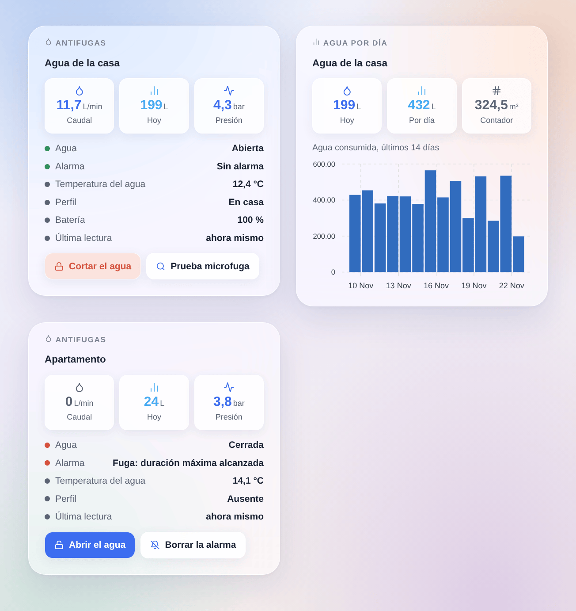

# SYR SafeTech

## Presentación

Esta integración trae su **protección antifugas SYR** a Gladys por la red local: la válvula de corte de su acometida de agua, sus alarmas de fuga, el caudal, la presión y la temperatura del agua, el agua consumida cada día y sus perfiles de protección. Puede cortar el agua desde Gladys y dejar que una escena lo haga cuando un detector de fugas se moje.

Se comunica con la **API local** del equipo (puerto 5333): sin nube, sin cuenta SYR, nada sale de su casa. Funciona con:

- SYR SafeTech Connect (V3, V4 y el modelo actual), SafeTech+ Connect, Trio DFR/LS Connect, Trio LS, SafeTech Lock y TRIO Lock Connect;
- Hansgrohe Pontos Base, RWC MultiSafe y los mismos equipos vendidos con otras marcas (CONEL, Sanibel, DITECH, TAKE, concept, Optima); probablemente también el «Wasserwächter» de POLYGONVATRO (mismo firmware, sin confirmar).

Los antiguos Safe-T+ y los descalcificadores LEX no tienen API local: solo hablan con la nube de SYR, que esta integración no usa.

Esta integración no está afiliada a SYR (Hans Sasserath). Se escribió a partir de la documentación comunitaria de la API local y **todavía no se ha probado con un equipo real**: sus comentarios son bienvenidos.

## Requisitos

- Gladys Assistant 5.3.0 o posterior.
- El equipo SYR conectado a su red (Wi-Fi o Ethernet) y accesible desde el servidor Gladys en el puerto 5333.
- Su dirección IP: aparece en el menú del equipo o en la lista de equipos conectados de su router de internet. Asígnele una **dirección fija** (reserva DHCP) en su router, para que no cambie.

## Configuración

| Campo                      | Qué introducir                                                                                                                     |
| -------------------------- | ---------------------------------------------------------------------------------------------------------------------------------- |
| Direcciones de los equipos | La dirección IP de su equipo, por ejemplo `192.168.1.40`. Varios equipos: sepárelos con comas.                                     |
| Lectura                    | Frecuencia de lectura de los equipos: cada 10 segundos, 30 segundos (por defecto) o minuto.                                        |
| Idioma de los textos       | Idioma de los nombres de funciones, de las alarmas y de los mensajes de escenas. Automático: el idioma del último widget mostrado. |

Pulse después **Buscar y probar**: la integración encuentra sola el equipo (la ruta reciente `/trio`, si no las antiguas `/safe-tec` o `/pontos-base`) y lo ofrece en la pantalla **Descubrir**. **Diagnóstico** escribe lo que sabe la integración en sus registros, para un informe de error.

## Uso

### Dispositivos

Añada el equipo desde **Descubrir**. Tiene las funciones que su modelo indica:

| Función                       | Qué es                                                                                                             |
| ----------------------------- | ------------------------------------------------------------------------------------------------------------------ |
| Suministro de agua            | La válvula, como interruptor: encendido = el agua pasa, apagado = cortada. No en un Pontos Base.                   |
| Fuga                          | Encendido mientras haya una alarma de fuga activa (volumen, duración o caudal máximo, microfuga, sensor de suelo). |
| Alarma                        | La alarma actual en palabras, «Sin alarma» si no hay.                                                              |
| Perfil de protección          | El perfil activo (En casa, Ausente, Vacaciones… tal como se llaman en la app SYR); puede cambiarlo.                |
| Caudal de agua                | m³/h.                                                                                                              |
| Presión, temperatura del agua | bar y °C, cuando el equipo tiene los sensores (no el Trio DFR/LS).                                                 |
| Contador de agua              | El total contado por el equipo, en m³.                                                                             |
| Agua consumida hoy            | Litros desde medianoche, calculados por la integración a partir del contador.                                      |
| Última extracción, en curso   | Litros de la última extracción, y de la que está en curso.                                                         |
| Batería, batería baja         | El nivel de la batería de respaldo cuando el equipo lo indica, y el aviso de batería baja.                         |

### Widgets del panel

- **Antifugas**: el caudal actual, el agua consumida hoy, la presión, la válvula, la alarma, el perfil y la batería, con botones para cortar el agua o volver a abrirla, borrar la alarma e iniciar la prueba de microfuga (Gladys pide confirmación antes de mover la válvula).
- **Agua por día**: el agua consumida en cada uno de los últimos 14 días, hoy y la media diaria. El gráfico se completa con los días.

### Escenas

Disparadores: **fuga detectada**, **alarma** (todas las alarmas, fallos incluidos), **alarma terminada**, **aviso** (corte de corriente, batería, aviso de fuga; solo equipos recientes), **no responde** y **responde de nuevo**. Cada uno puede limitarse a un equipo y pasa sus textos a la escena (`{{triggerEvent.data.message}}`).

Acciones: **elegir un perfil** (por su número en la app SYR), **prueba de microfuga** (la válvula se cierra unos 4 minutos), **borrar la alarma**, **agua consumida** (hoy, ayer, contador, caudal, válvula, para un mensaje o una condición).

Ejemplos:

- Cuando un detector de fugas Zigbee bajo el fregadero se moja → apagar el suministro de agua SYR y enviar un mensaje.
- Cuando se activa la alarma de la casa → elegir el perfil 2 («Ausente»), con límites más estrictos; volver al perfil 1 al desactivarla.
- Cuando SYR detecta una fuga → enviar `{{triggerEvent.data.message}}` a todos y apagar la caldera.

## Solución de problemas

- **«Sin respuesta de … en el puerto 5333»**: compruebe la dirección, que el equipo está encendido y conectado, y que nada bloquea el puerto 5333 entre Gladys y el equipo.
- **«responde, pero no como un equipo SYR»**: la dirección es de otro equipo, o su modelo no tiene API local (Safe-T+, LEX: solo nube).
- **Falta el interruptor de suministro de agua**: el Pontos Base no se puede controlar por su API local; los demás siempre lo tienen.
- **«El equipo ha rechazado la orden»**: el firmware no conoce la orden (código NSC) o el valor (MIMA), por ejemplo un perfil que no está activo.
- Abra una issue en GitHub con las versiones de Gladys y de la integración, el resultado de **Diagnóstico** y, si puede, la respuesta de `http://<dirección>:5333/trio/get/all` (o `/safe-tec/get/all`) sin el número de serie.
